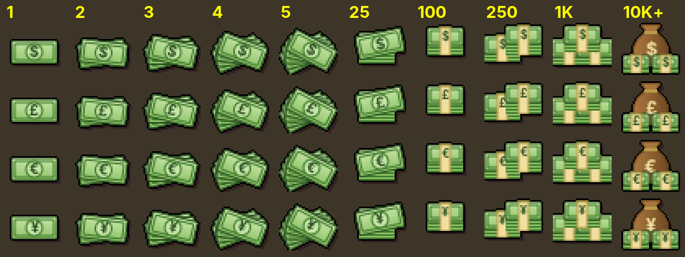

# Gold to Currency

A RuneLite plugin that shows Old School RuneScape gold, and the Grand Exchange value of items, in USD or another real-world currency.

## Features

- **Money icons**: coin piles are redrawn as cash in your chosen currency. Bigger stacks get bigger piles,
  using the same thresholds as the game's coin sprites: a single bill at 1, a fan of bills up to 5,
  a loose stack at 25, banded bundles at 100, 250 and 1,000, and a money bag at 10,000+.
  The stack label can show the gold amount (default), the currency value, or nothing.

  

- **Hover tooltip**: hover coins, platinum tokens or any tradeable item (inventory, bank, equipment, etc.) to see its value, for example `Value: $4.21`.
- **Inventory infobox**: shows what the coins in your inventory are worth.
- **16 currencies**: USD, GBP, EUR, CAD, AUD, NZD, BRL, MXN, JPY, CHF, SEK, NOK, DKK, PLN, INR, PHP.

## How the rate works

By default the rate comes from the **Old School Bond**, the official way to buy gold:

```
value = gp × (bond store price ÷ bond Grand Exchange price)
```

The bond's GE price updates live from RuneLite's price data. Enter what a bond costs in your
currency under **Bond store price**, which defaults to 7.99. Change it if your store price is
different, and whenever you switch currency.

You can also switch **Rate source** to **Custom rate** and enter the value of 1M gp yourself.

The plugin makes no network requests of its own.
